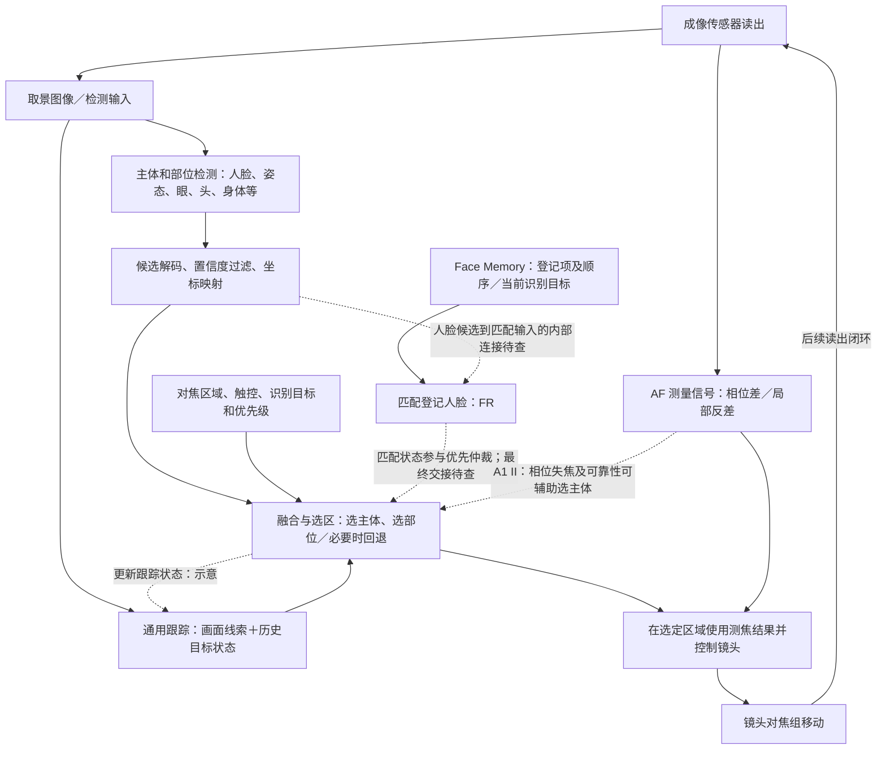

# Sony Alpha 自动对焦：从视觉检测到镜头动作

范围：工作区中的 A7 IV 6.02、A7R V 4.00、A1 II 4.00。下文区分 **原厂公开行为**、**本地固件/原图验证**和**推断或待查**。框图是功能数据流，不是 Sony 公开的内部设计图，也不是逐帧调用顺序。

## 1. 总体框图

这是总览。下文的「分数与状态」清单区分原始张量、CP 结果和后续仲裁；[跟踪专题](AF-VISUAL-TRACKING.md)记录外观跟踪、人物轨迹和失焦辅助选目标；[注册人脸专题](AF-REGISTERED-FACE.md)区分登记匹配 FR 与跨帧 ReID。



- **检测回答「哪里有谁、哪个部位」**：输入是图像，输出可能是分类与框回归，也可能是关键点热图。网络张量不是屏幕上的对焦框，更不是镜头步数。
- **跟踪回答「下一帧还是不是同一个主体」**：主体识别给的是类别和部位，跟踪需要跨帧维持选中对象。Sony 在 α9 II 的 Real-time Tracking 资料明确列出颜色、亮度图样和主体距离，并说明与脸/眼线索配合。这能说明多线索的设计思路，不能据此认定本项目三机共用同一关联器，也不能仅凭 `reid_NHWC` 的名字断定生产链里的身份匹配策略。
- **AF 控制回答「该往哪边调、调多少」**：以 A7R V 规格中的 Fast Hybrid AF 为例，相位测量利用不同入瞳视图的相对位移估计失焦方向及大小；反差测量用局部清晰度变化寻找峰值。选定区域给出测哪里，不等于直接给出测量值。两种测量怎样选用、怎样处理延迟及怎样驱动镜头，没有从本地检测模型恢复。

## 2. 一帧里视觉分支做什么

1. **选搜索条件。** 对焦区域、触控起点、AF 触发方式、识别类别、已有跟踪状态都会影响结果的使用。常规主体优先 AF 和自定义键的专用识别 AF 行为不同：以 A7R V 手册为例，常规模式优先使用指定对焦区内或附近的识别结果，找不到则进行普通 AF；专用键可在全画面寻找，只对识别到的主体对焦。对焦区限制结果选择，不证明神经网络只看那个矩形。
2. **生成网络输入并推理。** 本机离线复现使用按槽准备的 RGB 输入，经缩放/补边后送进原固件 NBG，保存变换供框回投。机内精确的取流格式、裁剪来源、方向处理、调用频率和槽执行顺序尚未完整证实，不能把离线 JPEG 预处理当作机内 ISP 流程。
3. **把密集输出变成候选。** 热图路径在栅格上定位关键点并组织成实例；检测头路径输出各尺度的分类和几何回归。槽 8、10 已用 [原始 Adam CPU 作业](ADAM-XHD.md) 从字节张量直接生成原厂候选记录，不再使用实验性先验和去重；人体姿态等另有尚未恢复的解码。
4. **选主体，再选部位。** 例如同一只鸟的眼暂不可用时，可优先选择仍能识别到的头或身体，前提是配置允许相应部位。识别灵敏度影响接受识别结果的倾向，跟踪切换范围影响离当前跟踪框多远仍可切换，跟踪持续级别影响暂失后是否继续追踪附近区域。这些是手册所述的行为，不是已知的数值公式或固定状态机。
5. **把选区交给 AF，下一次读出再更新。** 以人转身为例，身体和头部姿态能在眼睛不可见时继续提供空间锚点；眼回来后可以重新使用眼部候选。不应解释成相机能看见被遮住的眼，也不应把识别框、当前 AF 所选区域和已合焦状态当成同一件事。

以鸟槽 8 的主机复现为例，量化卷积逐层提取特征，池化和降采样获得不同尺度的特征网格。检测头在每个位置对多个候选给出类别和几何偏移，另有辅助张量。量化输出按各自的 `scale × (raw − zero_point)` 转为实数；实验解码器在 `40×40` 网格按每个候选的类别 softmax 选点，用框回归和实验先验生成框、去重，再撤销缩放与补边。人体槽不走这个构框办法：主机截取热图局部峰值，把同一个人的响应关联起来后才生成框。这两类输出都不能从单一峰值直接读出原厂对焦点。

## 3. 原始固件和模型确认到了哪里

| 路径 | 已有实证 | 不能由此推出 |
|---|---|---|
| A7R V / A1 II 人体槽 1 | 两机原图相同。`512×336` RGB，输出两个 `64×42` 栅格，分别为 19 通道热图及 40 通道伴随张量。主机热图聚类在样例上定位六人，天际线对照零框。 | 40 路完整定义、机身人体实例关联算法、人体姿态与眼/脸结果的逐帧融合。 |
| 两机鸟槽 8、飞机实验槽 10 | `320×320` RGB。鸟槽由量化卷积主干及多尺度检测头组成，六层网格为 `40、20、10、5、3、1`；18 个实际写出的分类、框回归和辅助张量，另有三个不写的接口槽。鸟和飞机在已测输入上分别有独立 GPU / x86 模拟器逐字节对照，并能接原 Adam 解码。 | 固件菜单一定选择这些槽及门限；模拟器与真实芯片已经逐字节对齐。 |
| 鸟类别资源槽 7 + 8 | 两机 RSC 明确配对。槽 7 为 `128×128` RGB 输入，有 `32×32×3` 空间输出；在手选裁片上，部分响应靠近眼、喙。 | 必然「槽 8 出框后槽 7 精修」、裁片如何自动生成，或槽 7 已独立找回漏检的整帧主体。 |
| 猫：A7R V 槽 12 / A1 II 槽 18 | 两者都有 `52×36` 空间输出，但接口不同。主机从热图构框，A1 II 样例只覆盖部分身体。 | 两代共用一套动物拓扑、猫的部分框即机身完整身体框。 |
| A7 IV：FDN / PDN | FDN 有正、侧脸字典与固件执行段；CP 原代码根据脸方向选 `FaceScore` 门限，处理方向、双眼、鼻根坐标。PDN 分别判双眼分数。发布包有可回放的门限初值。 | A7 IV 完整 DSP 数值前向已跑通、默认门限就是所有场景的运行值，或它在用两款新机的 NBG。 |

本地证据：[主机实测](HOST-CPU-RESULTS.md)、[鸟槽 8 和槽 7 对照](SLOT08-CUDA.md)、[飞机槽 10](SLOT10-CUDA.md)、[A7 IV SA 执行段](A7IV-SA-FORWARD.md)、[A7 IV CP 与发布参数](A7IV-WBI2-DETECTOR-EVIDENCE.md)。老笔记中的「`.nab` 只能做场景分类」「主机不能执行原图」不能用来概括这里已有的可执行检测槽；共有 `.dic` 文件哈希相同也只证明对应文件复用，不证明三机使用同一视觉检测流水线。

### 从张量到原厂候选框

```text
原固件量化 NBG ── 已离线执行 ──▶ 原始张量
                                      │
                    原 Adam CPU 解码已验证（槽 8、10）
                                      ▼
CP 接收 XHD 记录 ── 已回放验证 ──▶ 整帧候选框、类别、部位、分数
                                      │
                     逐帧主体仲裁／AF 选区绑定待查
                                      ▼
                               机身对焦与显示
```

XHD 结果层有明确边界：每条 12 字节，由两个 Q14 角坐标、`type`、`part` 和 Q15 分数组成，上限 50 条。CP 按搜索区尺度换算，按方向旋转、平移并裁剪到整帧；过小的框可保留但清零分数。`part` 字段存在，不代表枚举全解。CP 置信度 getter、XHD/NMS 配置字节、XHD 结果分数和主机 softmax 是不同层的量，不能互换。见 [XHD 原指令结果转换](CP-XHD-RESULT.md)、[XHD/NMS 接口与发布默认值](CP-XHD-NMS.md)、[CP 置信度](CP-CONFIDENCE.md)。

此处的未知只指**有视觉 AI 的路径**：上图 `D → P` 是张量到候选，`P → A` 是候选到接受/选区。`F → L` 是测焦后驱动镜头，不在本项未知里。普通 AF 可以在没有识别结果时照常选择/使用 AF 区域，不经过 `D → P`。另见 [分数到二值的证据与边界](AF-VISION-ACCEPTANCE.md)。

### 分数与状态不是同一个量

| 标记 | 来源、数值域 | 实际用途与证据边界 |
|---|---|---|
| `H_pose` | 人体槽 1 空间热图；另有 40 路伴随张量 | 空间响应，不是人体实例置信度。原厂 JNP 人体列表有数量与部件记录；槽 1 到该列表的峰提取、分组与门限尚未复现。 |
| `H_xed`, `S_peak` | XED 局部热图处理的输入响应，以及作业输出记录中的定点峰分数 | `heat_th`、峰选择参数是作业输入；CP 回读左眼/右眼/鼻各路计数及已有峰。零峰跳过该路，不等于整帧无人，也未证明峰分数等于热图像素值。 |
| `C, B, A_aux` | XHD 相关 NBG 的量化分类、框回归与辅助张量 | 类别响应、几何偏移和辅助量分别存放。槽 8、10 已向 Adam 喂入原张量及发布门限；不把 `thr_per` 当作已知的 NMS IoU 门限。 |
| `S_host` | 项目鸟/飞机实验中的每锚框 softmax，或人体/动物构框后的实验打分 | 离线排序和画图用，不是相机结果字段；离线去重 IoU 也独立于机内几何门。 |
| `S_xhd` | CP 已收到的 XHD 候选 `u16 / 32768`，转换不钳到 1 | 结果记录分数。坐标另用 Q14；裁剪后短边不合格可清分而不删记录。没有证明它等于 `C` 的 softmax，也未绑定到所有 CP 置信度比较点。 |
| `T_mid`, `T_high` | CP Face/XHD 配置 getter 的 FP32 门限 | 可读原发布配置；按目标索引和相关灵敏度、类型/部位选择。它们是配置，不是一次检测输出，不能推定获得/保持滞回。 |
| `G`, `T_overlap` | A7R V 的两个矩形 `交集面积 / 较小框面积` 与独立几何门限 | `G < T_overlap` 清一路标志，相等不清。已读发布配置 `0.30`，无效字段回退 `0.90`；不是类别分、不是 IoU、不是全模式常量。另有名为 `IOU` / `DIST` 的条件重算分支，不和这道门合并。 |
| `S_fdn`, `S_pdn` | A7 IV CP 结果的有符号脸分、左右眼分 | FDN 按方向选门限；PDN 两只眼各自严格做 `score > threshold`。与上述热图/峰和 XHD 的编码不同，不换算为通用概率。 |
| 跟踪响应、轨迹相似度、状态计数 | Staple 诊断有响应置信字段；人物关联有姿态/轨迹相似等线索；A7R V 另见验证计数和枚举 | 这些对应外观/关联/历史，不是语义分数。没有证实统一加权公式，也不把验证调用次数写成帧数。 |
| `defocus` 和测焦可靠性 | 光学测量；A1 II 有用可靠失焦辅助选主体的指令引用 | 不等于分类分或绝对物距；如何接到最终镜头控制不由这些模型给出。 |

原指令与配置交叉证据见[检测判定总表](AF-DETECTION-DECISION.md)。图中的候选、有效位、跟踪状态、最终选区和镜头合焦是五个不同的接口；这几类数据不能用同一个「检测成功」布尔值替代。

## 4. 机型差异与下一步验证

- **A7 IV** 官方称 Face/Eye AF，菜单支持人、动物、鸟；不能从固件中的 PDN 字典直接推断它拥有 A7R V 同样的用户可见姿态识别能力。
- **A7R V** 官方明确使用 AI 处理单元与人体姿态估计，识别类别扩展至昆虫、汽车/火车、飞机等。机内的姿态信息和离线人体热图结果一致支持「不只看脸」这个机制，不足以证明每项原厂解码细节。
- **A1 II** 官方支持由相机自动决定识别类别。项目用鸟槽和飞机槽分别推理再合并是离线验证，不是 Auto 跨类调度证据。

最值得补的是同一输入的配对证据：**实际选中的任务/槽与搜索区 → 原始 NBG 输出 → XHD 候选缓冲区 → 最终选择的主体/部位**。优先对鸟类验证槽 7/8 和搜索区生产者，再用受控遮挡及两主体交叉片段区分保持原主体、切换部位、换主体三种行为。仅凭样例叠图不能逆推出置信度、模型执行频率或跟踪分配算法。

## 原厂资料

- [A7 IV：Face/Eye Subject](https://helpguide.sony.net/ilc/2110/v1/en/contents/TP1000657934.html)；[Eye AF 行为](https://helpguide.sony.net/ilc/2110/v1/en/contents/TP1000657952.html)；[识别框与合焦框](https://helpguide.sony.net/ilc/2110/v1/en/contents/TP1000657948.html)。
- [A7R V：AI 和人体姿态发布说明](https://sony.mediaroom.com/2022-10-26-Sony-Electronics-New-Alpha-7R-V-Camera-Delivers-a-New-High-Resolution-Imaging-Experience-with-AI-Based-Autofocus)；[主体识别 AF](https://helpguide.sony.net/ilc/2230/v1/en/contents/TP1000669439.html)；[识别目标与详细设置](https://helpguide.sony.net/ilc/2230/v1/en/contents/TP1000669441.html)；[规格：相位检测／反差检测](https://helpguide.sony.net/ilc/2230/v1/en/contents/TP1000669431.html)。
- [A1 II：主体识别 AF](https://helpguide.sony.net/ilc/2440/v1/en/contents/211h_about_eye_af.html)；[Auto 识别目标](https://helpguide.sony.net/ilc/2440/v1/en/contents/211h_recognition_target.html)。
- [α9 II：Sony 对实时跟踪线索的说明](https://sonyglobal.akamaized.net/is/content/gwtvid/pdf/2019/ILCE-9M2/brochure.pdf)。
