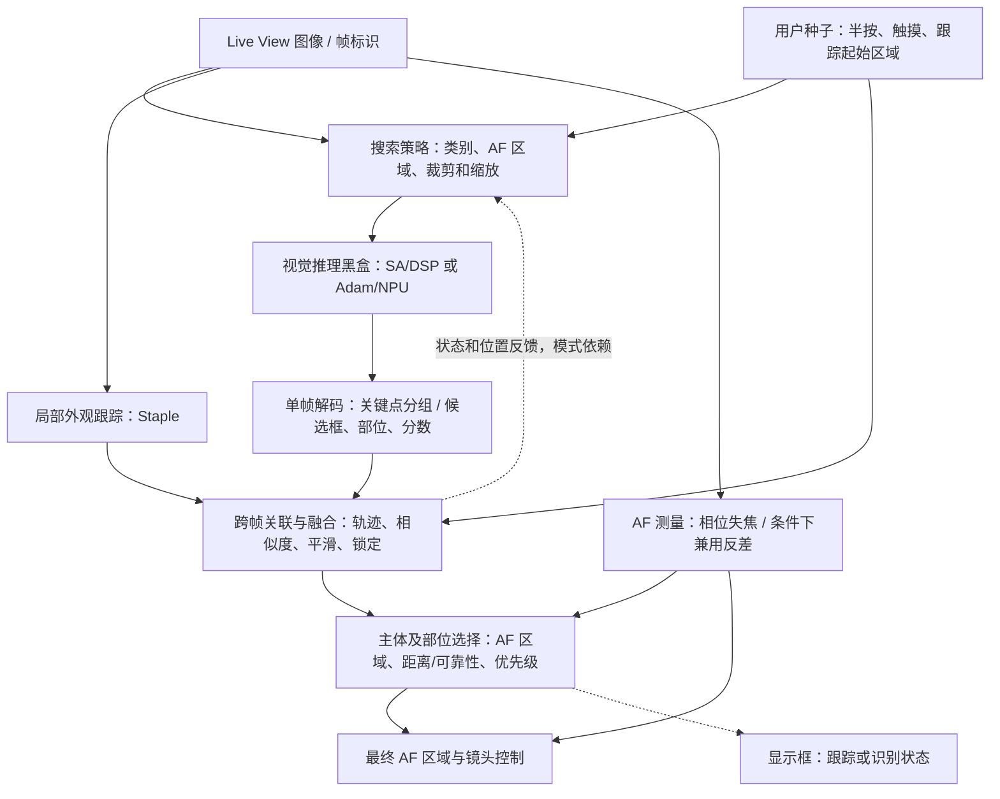

# Sony Alpha 对焦：视觉检测、跨帧跟踪与主体选择

范围：A7 IV 6.02、A7R V 4.00、A1 II 4.00 的本地发布固件，2026-11-19。只做离线静态分析、局部原指令回放和已存预测重统计，未连接机身。本文不拆网络内部，也不把三台机器和所有主体类别画成同一条已证调用链。

**结论：识别 AF 不是用单帧最高分的框直接驱镜。** 厂商公开区分跟踪框和识别框，并允许先跟踪未识别物体、命中后接管到身体/头/眼。固件中也能分别看到传统图像跟踪、人物轨迹和融合、用户锁定状态、失焦量辅助选主体。这些主要改善「已经指向谁后能否跟稳」和「应该用哪个部位对焦」；不能保证从冷启动就找出所有目标，也不能证明当前 COCO 差距主要是缺了时域算法。

证据标记：**回放** = 原指令用给定数据执行过；**静态** = 本轮从镜像检查指令或引用；**线索** = 固件名称、日志、RTTI，尚未复原完整函数或调用顺序；**公开** = Sony 对外行为。图中箭头是功能数据流，不等同于已闭合的固件调用图；虚线尤其不保证所有模式都有。

## 总体框图



空间上建议把信号分成三类：视觉候选回答「像什么、在哪」；跨帧状态回答「是不是刚才那个」；光学测量回答「选定位置离合焦还有多少」。最后一类不是 NBG 输出的深度，也不是把识别框中心直接当镜头位置。见 Sony 的 A7 IV 混合 AF 和跟踪说明 [S1]、A1 II 跟踪框切换说明 [S2]。

## 模型黑盒与调用边界

| 机型/路径 | 调用输入 | 单帧输出与消费者 | 已知断点 |
|---|---|---|---|
| A7 IV FDN/PDN | FDN 冷启动调度选择原厂作业；CP 包含图像/步长/搜索窗、缓冲地址、字典和作业字段，SA 接管局部图像搬运与计算。 | FDN 的 CP 消费端读方向、原始脸分、两眼/鼻根坐标，按方向门限给有效标志，再交给 FC listener；没有直接输出 `xyxy`。PDN 消费端对左右眼分数独立判定。 | 原 CP 请求打包、消费者和 listener 回放通过；不是从真实图像贯通到镜头。原始记录 `execId` 在 FDN 消费者用于日志，正常输出另取管理器字段，不能当主体 ID。 |
| A7R V / A1 II 人体 Pose | 槽 1 宿主输入为 `512×336×3` 单张张量；CP 的 Adam 参数诊断出现画布尺寸/步长、颜色转换、裁剪旋转、输入输出地址和网络索引。 | 两个 `64×42` 张量，19 通道定位热图与 40 通道连接场候选；原驱动的 JNP 描述包含峰提取、偏移、PAF、人体分组。另有眼/鼻细化和 ReID 裁剪及相似度命令线索。 | 未证明主机 RGB letterbox 是原生预处理；未把全部通道、原生分组、ReID 输入输出、实际作业节拍逐项绑定。 |
| A7R V / A1 II XHD | 已回放 `AdamXhdDriver` 的参数/结果视图和长短描述符，含 NPU 输出地址、NMS ID、各类部位门限等。宿主槽 8、10 可单图运行 `320×320×3`，不能仅凭这一点确认菜单到槽的运行时绑定。 | CP 端接收最多 50 条 `(Q14两角, type, part, u16分数)`；原指令将其缩放、旋转、裁剪到整帧，分数按 `/32768` 转换，特定小框只清分。另有按类型/部位/灵敏度选择门限的接口。 | 原张量到 XHD 记录的解码与 NMS 执行器仍未闭合，描述符的首个作业消费者也未绑定。`ddl_saCalcStart` 的三个既有交叉引用不能证明这条 XHD 提交链。 |

细节与原指令测试：[A7 IV SA](A7IV-SA-FORWARD.md)、[A7 IV CP](A7IV-WBI2-DETECTOR-EVIDENCE.md)、[人体 I/O](COCO-KEYPOINTS-ASSESSMENT.md)、[XHD 调用参数](CP-XHD-NMS.md)、[XHD 结果](CP-XHD-RESULT.md)、[门限](CP-CONFIDENCE.md)、[区域缩放](CP-REGION-SCALE.md)。不同阶段的分数不可互换；NMS 也是同帧候选处理，不是跨帧去抖。

## 时间域：实际在巩固什么

1. **先有区域/目标，再细化身份和部位。** A7 IV 支持从 AF 区域或触摸启动跟踪；A1 II 的官方示例明确允许普通跟踪先跟住远处目标，靠近后切到身体、再到脸或眼，转身则可回到头/身体。`Tracking Shift Range` 是普通跟踪向识别目标接管的空间容忍度，不等同于分类阈值，也不能由菜单行为直接断言模型裁剪尺寸。[S1][S2]
2. **独立局部跟踪。** 三份 CP 镜像都有 `Staple` 与前/背景直方图、HOG、响应合并、AF 区域和失焦字段；A7R V 还有 `FrameCalc`/`update`。A1 II 的 `GetStapleTrackResult` 指令确实准备了 `is_lost`、`is_occluded`、总/HOG 响应置信字段和丢失门限等诊断实参；另有从 `LateFusionHumanData` 设置 Staple 初始化和把 Staple 结果交回轨迹流程的命名。公开 Staple 论文的基线是相关滤波模板与颜色直方图互补；Sony 的 DSP 内核、更新门控、融合权重以及各模式是否执行仍未复原。不能把论文默认参数套进机身。[S3]
3. **人物关联、预测与去抖。** A7R V/A1 II 包含 `HistoryHumanFrame`、`HumanTracklet`、`FrameTrackHumanData`、`PoseTrackHumanData` 和 `LateFusionHumanData`。A1 II 可定位 `calcPoseSimilarity`、`calcTrackletOverlapRatio`、`calcSimilarityCoef`、`Smoother::smoothing` 和 `calcVelocity`；ReID/相似度网络及 `predicted_pos` 也有独立证据。A7R V 的速度函数原指令遍历链表并读取每记录字段。几何、姿态、外观及历史均有候选入口，但尚未证明各项共同使用的匹配公式、求解器或滤波类型；不称其为 Hungarian、Kalman，也不把人体模块直接外推到鸟或飞机。
4. **丢失不是立即换人。** 两机 `judgeTrackingLost` 相关代码确实读旧锁定字节并写回当前值；A1 II 在当前位为零的分支后续路径中使用旧位布尔值。A7R V 在 `subject_tracking_judger` 路径能定位 `Lost -> ObjTracking` 和 `ObjTracking Failed` 的条件分支，A1 II 还有 `Face -> ObjTracking` / `ObjTracking->FaceTracking` 日志线索。A1 II 的 `SearchModeSwitcher` 指令读取/更新时间状态并做阈值比较，日志分别列出距最后识别、仅体检出等时间和 ZPD 有效性；这支持有状态搜索策略，但未闭合从数值搜索状态到具体检测器、ROI 和帧间隔的映射。官方 `Tracking Persistence Lvl` 则描述了失认后在附近继续跟和更快转给另一较近主体的取舍；A1 II 的这项菜单仅对指定非人物类别开放，不能用它反推人物状态机参数。[S2][S4]
5. **相位/失焦可以参与选谁，不只在末端驱镜。** A1 II 的 `PriorityDefocusSubjectSelector` 有 `getMinReliableDefocusFace`、锁定框、AF 点重叠、face/head/body 的最小失焦等指令引用；还有 `phase_tracklet_updater.cpp` 和 ZPD 校验诊断。稳定可测焦的候选可以与高语义分但不合适的候选区别处理。证据目前限于相关功能路径，不是所有目标都用同一个失焦阈值，`defocus` 也不是绝对物距。

**一段可核对的行为示例**：从指定区域启动普通跟踪 → 识别身体后可接管 → 眼进入可见范围后可切至眼 → 眼消失时可退到头或身体；主体失认还有普通物体跟踪的回退路径。它是状态转移示例，不是保证每一帧都运行视觉模型、也不是反编译得出的固定优先级。A1 II 宣传的最高 120 次/秒是 AF/AE 计算，不是 NBG 推理频率。[S2][S4]

### 静态取证索引

以下均为文件偏移，Thumb 本地分支按同一文件基址显示；绝对指针用文件偏移加 `0x108000`。三镜像 SHA-256 前缀依次 `7b9b137d696e5972`、`3269bf6242633979`、`96b41427958c1b41`；A1 II 用 `debug/deepseek_pose_dispatch/fw/a1ii_cp/cpapp-b.bin`。`strings -a -t x` 找诊断偏移；只有能用同寄存器 `movw/movt` 和附近消费指令复核的项才标「指令」。

| 机型 | 证据 | 观察 |
|---|---|---|
| A7 IV | 字符串 `+0xcfa254/+0xcfa41f/+0xcfa446/+0xcfe214` | `histMergeFactor`、响应合并、`defocus`、前/当前脸锁定；不证明有 A1 II 的人体 MOT。 |
| A7R V | 指令 `+0x1a8f62..+0x1a8fa2`、`+0x1a8fc8..+0x1a9116` | 消费状态字节，经不同条件产生失败或重新进入物体跟踪日志；记录写入区别于仅命中名称。 |
| A7R V | 指令 `+0x1aa51c..+0x1aa588`；`+0x1ca030..+0x1ca096` | 前者引用速度函数签名并循环读记录；后者把旧 `[sl+0xc]` 送诊断后写入当前布尔值。 |
| A1 II | 指令 `+0x1d23ce/+0x1d2adc/+0x1d739e/+0x1d766a/+0x1d9a08/+0x1ddcf6` | 分别形成姿态相似、轨迹重叠、相似度系数、平滑、主体排序、速度函数的签名地址；不据此推断它们在同个回调中的执行顺序。 |
| A1 II | 指令 `+0x72c174..+0x72c1b8`、`+0x20132e..+0x201346`、`+0x2013c2` | Staple 回报准备；丢失判定读取旧 `[r4+0xc]`，保存当前状态；当前为零时将旧位布尔值送往公共后续路径。 |
| A1 II | 指令 `+0x76ca2c..+0x76ca8c`、`+0x76cc90..+0x76cd52` | 时间差换算、比较与状态记录；同路径引用搜索模式的两组诊断。 |
| A1 II | 指令 `+0x1d4738/+0x1d52aa/+0x1e3744`；字符串 `+0xf4127d/+0xf4524f` | 头部失焦候选、可靠最小失焦函数、相位轨迹更新文件引用；身体失焦和轨迹更新 ZPD 校验诊断。 |

## 对 COCO 低分的拆解

重统计已有 `simulator` JSONL（这里是独立前向的舍入模式名），不改推理，不重新打分训练，不借机身。正图定义为至少一个有效的同组非 crowd 标注。命中以 `IoU ≥ 0.5` 判断；Top-1 取正图最高分，Oracle 允许从**已存候选**完美挑选，实例栏做最大基数一对一匹配，不用分数排序。保留文件中全部候选也不是获得全部模型输出：鸟/飞机文件在保存前已做实验解码、最低分过滤和 NMS。

| 分支 | 正图有候选 | Top-1 命中正图 | Oracle 命中正图 | Oracle 实例召回 | 有输出的负图 / 负图数（全候选；分数 ≥0.85） |
|---|---:|---:|---:|---:|---:|
| 鸟，槽 8 | 88/125 | 28/125 | 29/125 | 46/427 (10.8%) | 1747；15 / 4875 |
| 飞机，槽 10 | 32/97 | 22/97 | 24/97 | 24/143 (16.8%) | 492；13 / 4903 |
| 动物，A1 II 槽 18 | 345/349 | 56/349 | 56/349 | 56/420 (13.3%) | 4459；712 / 4651 |

- **鸟/飞机：单改排序不够。** 对已有候选完美挑框，正图命中只多 1 张和 2 张。分别有 37/65 张正图没有候选，另有 59/8 张虽有候选却无 IoU 合格框。第一次冷启动的损失应先查运行时槽、ROI/颜色/尺度、原生候选生成和坐标变换；不能指望时域排序补回不存在或位置不对的候选。
- **动物：先别把「每图一框」解释成模型认错。** 宿主方案合并所有过阈值的热图峰，最多一框，以最高峰排序，不是原厂实例分组或负图判定。它在 4459 张负图出框、0.85 后还剩 712 张负图且无正图 IoU 命中，首先暴露当前解码/分数不能直接当检测器；不是调高阈值就同时解决召回、分组和误报。
- **时域补偿有明确边界。** 好的先验 ROI 可能提供更合适的模型输入，Staple 可在已有正确种子后继续提供位置，跨帧和光学门控可减弱瞬时错误并避免换错人；但错误种子也可能被持续追踪，连续误检并不独立，持久性并不保证精度提升。COCO 静态全实例评估没有启动提示、前帧或失焦数据，还要求拟合全物体框；AF 可能只需在指定对象的一只眼、头或局部取得合格测焦。仍应保留真正的冷启动检测对照，不能用跟踪体验抹掉静态低分。

复现（项目根目录）：

```powershell
$py = 'E:/anaconda3/envs/test311/python.exe'
$r = 'runs/coco2017-eval'
$ann = "$r/data/annotations/instances_val2017.json"
& $py -B tools/coco_af_candidate_ceiling.py $ann "$r/sony-08-simulator.jsonl" bird bird
& $py -B tools/coco_af_candidate_ceiling.py $ann "$r/sony-10-simulator.jsonl" airplane airplane
& $py -B tools/coco_af_candidate_ceiling.py $ann "$r/sony-18-simulator.jsonl" animal cat dog
& $py -B -m unittest discover -s tools -p 'test_sony_cp_*.py' -v
& $py -B -m unittest discover -s tools -p 'test_a7iv_fdn_cp_*.py' -v
```

## 下一步如何验证贡献

1. **先拆单帧误差。** 固定同批片，比较实际全图调度、用上一帧目标构造的局部 ROI、以及用 GT 构造的 ROI 上限。分别记录原始层响应峰、候选中心落入目标、部位命中、各级分数与框 IoU；把 Sony 原生解码与现有实验解码跑在同一批输入上。GT ROI 是有提示上限，不能当无提示 AP。
2. **再测不同初始条件的时域增益。** 用带 ID/可见性标注的序列分别做无提示冷启动、正确种子、错误种子、交叉/遮挡，以及持续负片段。分开统计首次锁定时间、跟丢率、重捕获时间、换错 ID 次数、负片段误接管和眼/头命中；对照检测独跑、加外观跟踪、加关联/锁定、加测焦信息。没有实测 ZPD 时只做有/无该数据的接口/夹具验证，不把它当机身收益。
3. **继续查两条优先调用链。** 沿 A1 II `SearchModeSwitcher` 返回值找裁剪生成及提交调用，区分全局搜、局部复核和跟踪中间帧；沿 `SeqMonPoseTrackImpl::getStapleTrackResult` 和 `PriorityDefocusSubjectSelector` 追到最终送 IDT/AF 的记录，再核对非人物 XHD 分支是否共享相同状态。当前没有可报告的开机默认调度频率、连续保持时长、Auto 仲裁公式或端到端增益。

## 公开来源

- [S1] Sony ILCE-7M4 Help Guide: [Tracking](https://helpguide.sony.net/ilc/2110/v1/en/contents/TP1000656464.html)、[Focus Area / hybrid AF](https://helpguide.sony.net/ilc/2110/v1/en/contents/TP1000640179.html)。
- [S2] Sony ILCE-1M2 Focus Setting Guide: [Tracking subject](https://support.d-imaging.sony.co.jp/support/ilc/autofocus/ilce1m2/en/11.php)；[Sony A1 II 产品资料](https://www.sony.com/en-qa/electronics/interchangeable-lens-cameras/ilce-1m2/specifications)称非识别主体也可结合颜色、图案和空间信息进行跟踪。
- [S3] Bertinetto et al., [Staple: Complementary Learners for Real-Time Tracking](https://arxiv.org/abs/1512.01355), CVPR 2016；是参照算法，不是 Sony 固件规格。
- [S4] Sony ILCE-1M2 Help Guide: [Recognition Target](https://helpguide.sony.net/ilc/2440/v1/en/contents/211h_recognition_target.html)；Sony [animal/bird focus guide](https://support.d-imaging.sony.co.jp/support/ilc/autofocus/ilce1m2/en/13.php)。
